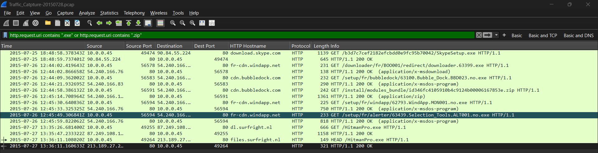
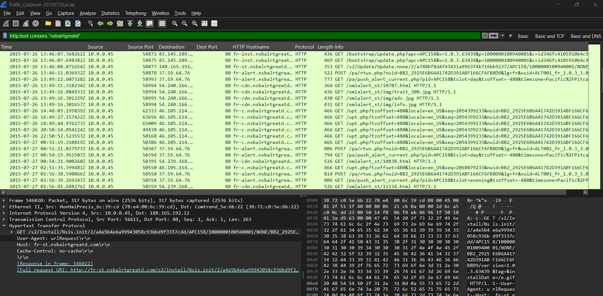
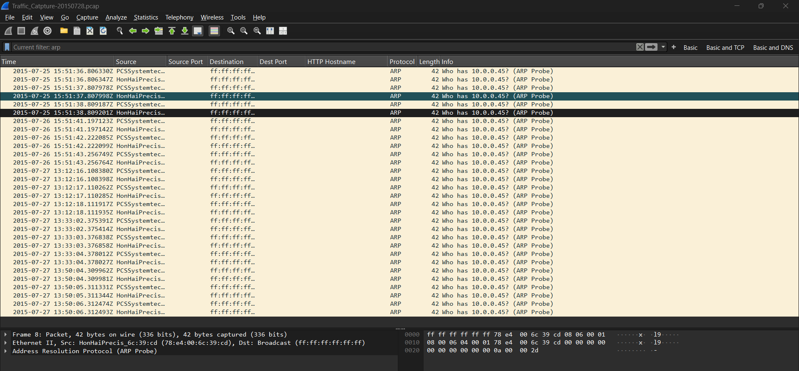

# Adware Incident Investigation: Host 10.0.0.45

**Type:** Team incident investigation (4 people) · **Tools:** Wireshark, Python, pandas

📄 **[Read the full incident report →](REPORT.md)** It covers the executive summary, timeline, MITRE ATT&CK mapping, impact, recommendations and IOCs.

## Summary

We were given a 62-hour packet capture (**1,437,980 packets**, July 25–28, 2015) from a single Windows endpoint and asked to find out what happened to it.

We found that a **Nosibay adware/PUP bundle** was installed about 21 hours into the capture. It then **beaconed to its command server roughly every 2 hours** for a day until the user removed it with Malwarebytes and HitmanPro. We also found several network hygiene problems: duplicate MACs on one IP, constant unanswered WPAD lookups, session tokens sent over cleartext HTTP, and obsolete SSL.

## Team and contributions

This was a group project (Group 2). The findings below are the team's combined work.

| Team member | Contribution |
|---|---|
| Kaushik Inguva (me) | Findings 1–4: the adware install, C2 beaconing, cleanup and duplicate-MAC conflict, including the Python timeline and beacon-interval analysis |
| Steven Johnson, Allen Bejoy, Hunter Hayes | Findings 5–9: WPAD/LLMNR exposure, cleartext session tokens, outdated SSL/TLS, external DNS, and Skype P2P/Dropbox LAN sync |

## Method

1. **Triage in Wireshark:** used Protocol Hierarchy, Conversations and Endpoints to get a picture of what normal traffic looked like for the host.
2. **Hunted with display filters:** looked for executable downloads, suspicious hosts, ARP anomalies and legacy protocols.
3. **Timeline and beacon analysis in Python:** exported packet data to CSV and used pandas to map DNS answers to IPs, build a timeline (T+ hours from capture start) and measure the intervals between check-ins.

## Findings

Findings 1–4 are mine. Findings 5–9 are my teammates' (see [Team and contributions](#team-and-contributions)).

| # | Finding | Severity | Evidence | Filter |
|---|---|---|---|---|
| 1 | **Adware bundle installed** (Bubble Dock, WindApp, Selection Tools) at T+20.87 h | High | A bootstrapper made an HTTP/1.0 call to `store.bubbledock[.]com`. Three `.exe` files and one `.zip` were delivered with `200 OK`, followed by install telemetry and a `1stime.php` registration. | `http.request.uri contains ".exe" or http.request.uri contains ".zip"` |
| 2 | **C2 beaconing** to `fr-c.nsbalrtgreatd[.]com/upt.php` | High | 13 check-ins about every 2.0 h (T+20.91 → T+45.04), ad alerts pushed to the host, and a persistent client ID. 304 requests went to 14 IPs. | `http.host contains "nsbalrtgreatd"` |
| 3 | **Cleanup** | Info | Uninstall callbacks at T+45.19, Malwarebytes and HitmanPro activity (2,136 update lookups) and 3 reboots. No beacons after T+45.05. | `http.host contains "surfright" or http.host contains "malwarebytes"` |
| 4 | **Two MACs claiming 10.0.0.45** | Medium | ARP probes came from both a VirtualBox adapter (`PcsCompu_3b:87:ab`) and a physical NIC (`HonHaiPr_6c:39:cd`), meaning a VM was bridged onto the same IP. | `arp` |
| 5 | Constant WPAD requests | Medium | 2,802 NBNS and 1,810 LLMNR WPAD queries, none answered. Anyone on the LAN could answer them and become the host's proxy. | `nbns.name contains "WPAD" or llmnr` |
| 6 | Session tokens over cleartext HTTP | Medium | Game-site `authUser`/`token` parameters sent unencrypted | |
| 7 | Outdated SSL/TLS | Medium | 2,041 SSLv2 and 127 SSLv3 Client Hellos, 61,384 TLS 1.0 | `ssl.record.version == 0x0002` |
| 8 | DNS bypassing local resolver | Medium | 32,086 queries sent straight to Google public DNS | |
| 9 | Skype P2P and Dropbox LAN sync | Low–Med | UDP 34862 to 624 external IPs, 13,930 Dropbox discovery broadcasts | `db-lsp-disc`, `udp.srcport == 34862` |

## Key takeaway

The adware itself was a nuisance. The bigger risk was the **unknown bootstrapper**, which could download and run code from outside servers for 24 hours without anything stopping it. We never found where it came from, so we recommended **reimaging the host** rather than trusting the cleanup.

## Indicators of compromise (defanged)

- Domains: `nsbalrtgreatd[.]com` (fr-c, fr-alert, fr-cdn), `bubbledock[.]com` (store, st, cdn), `windapp[.]net` (fr-cdn, fr-inst, fr-st)
- URI: `/clients/nosibay/bubbledock/v1/acc/1stime.php`
- Tracking ID: `BB2_2925E6B6A41742D391ABF166CF6FB8D9`
- **Block by domain, not IP.** The infrastructure sat on shared Amazon/OVH hosting, so blocking IPs would hit legitimate sites.

## Screenshots

**Finding 1: the adware bundle being delivered.** Three `.exe` files and a `.zip` came back `200 OK` within two minutes on July 26. The HitmanPro download on July 27 is the cleanup.

**Finding 2: C2 check-ins.** Repeated `upt.php` calls to `fr-c.nsbalrtgreatd[.]com` carry the same persistent `nuid` tracking ID, and ad alerts are pushed through `fr-alert`.

**Finding 4: two MACs probing for 10.0.0.45.** Each ARP probe arrives in pairs, one from a VirtualBox NIC and one from a Hon Hai physical NIC.

