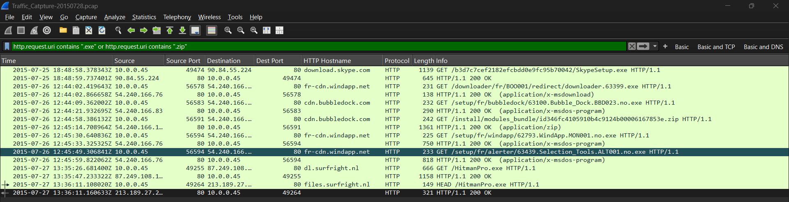
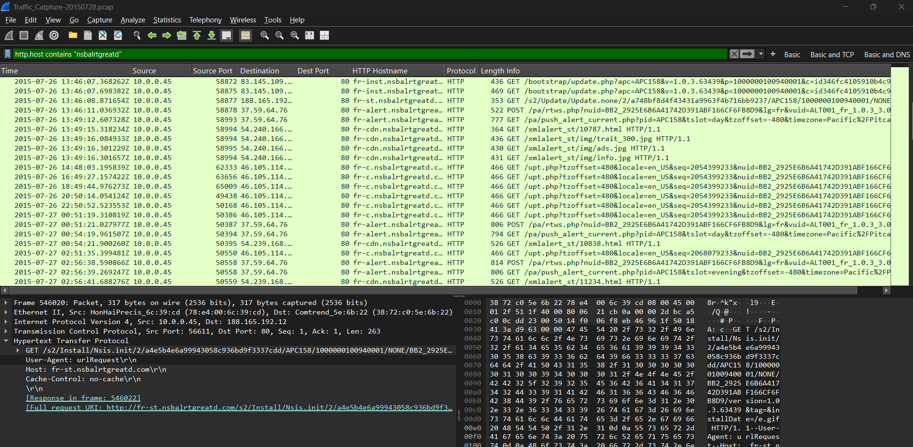
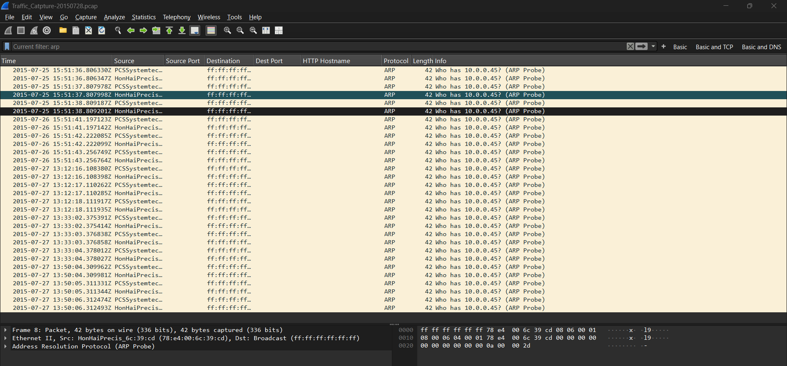

# Incident Report: Adware/PUP Infection on Workstation 10.0.0.45

| | |
|---|---|
| **Report type** | Post-incident network forensic analysis |
| **Organization** | AZTek Corporation (simulated, from a course scenario) |
| **Affected asset** | Windows workstation 10.0.0.45 |
| **Evidence** | `Traffic_Capture-20150728.pcap`, 1,437,980 packets, 62.45 hours |
| **Incident window** | 2015-07-26 12:44 UTC to 2015-07-27 13:03 UTC (about 24 hours) |
| **Overall severity** | **High** |
| **Status** | Contained by the user's cleanup. The host should be reimaged. |
| **Analysts** | Group 2: Kaushik Inguva (Findings 1–4, timeline, IOCs), Steven Johnson, Allen Bejoy, Hunter Hayes (Findings 5–9) |

> All indicators in this report are defanged (`[.]`, `hxxp`). This is an academic exercise using a training capture.

---

## 1. Executive summary

On 26 July 2015, a program that was already running on workstation 10.0.0.45 downloaded and installed an adware bundle from the **Nosibay** pay-per-install family, made up of *Bubble Dock*, *WindApp* and *Selection Tools*. For the next **24 hours** the workstation contacted the adware operators' servers **every 2 hours**. Each time it sent a unique tracking ID and received ad pop-ups. On 27 July the user removed the bundle with Malwarebytes and HitmanPro, and the check-ins stopped.

The adware itself caused limited harm. The serious finding is that **an unknown program could download and run code from the internet for a full day without anything blocking it**. Where that bootstrapper came from could not be determined, so the cleanup cannot be trusted. **We recommend reimaging the workstation.**

The investigation also found several weaknesses that made the host easier to attack and harder to monitor:
- an IP conflict between two network cards
- unanswered WPAD proxy lookups
- session tokens sent in cleartext
- obsolete SSL/TLS
- DNS that bypassed the corporate resolver
- unsanctioned peer-to-peer and file-sync software

## 2. Scope and methodology

**In scope:** all traffic in the capture. Every IP packet in it goes to or from 10.0.0.45, so it is effectively a capture of a single endpoint.

**Out of scope:** the host's disk, memory and logs, which were not available. Conclusions about what ran on the host are inferred from its network behavior.

**Approach:**
1. **Baseline:** Wireshark *Protocol Hierarchy*, *Conversations* and *Endpoints*, to understand what normal traffic looked like for the host.
2. **Hunt:** targeted display filters for executable downloads, suspicious hostnames, ARP anomalies and legacy protocols. Each download was confirmed by its server response (`200 OK` with an executable content type), not just by the request.
3. **Timeline:** the packet list was exported to CSV and analyzed in **Python/pandas**. DNS answers were joined to destination IPs so each HTTP request could be tied to a hostname. Beacon intervals were measured, and every event was placed on a T+hours timeline.
4. **Clock:** absolute times were confirmed from Unix timestamps embedded in HTTP query strings. The capture runs from about 2015-07-25 15:51 UTC to 2015-07-28 06:18 UTC.

**Limitations:** the capture contains 7,824 "previous segment not captured" warnings, so some packets were dropped. All counts are lower bounds.

## 3. Incident timeline

Times are given as T+ hours from the first packet, with approximate UTC.

| T+ (h) | UTC (approx.) | Event |
|---|---|---|
| 0.00 | Jul 25 15:51 | Capture starts. Two different MACs send ARP probes for 10.0.0.45. |
| 2.96 | Jul 25 18:49 | `SkypeSetup.exe` downloaded from `download.skype[.]com` (unsanctioned software, Finding 9) |
| **20.87** | **Jul 26 12:44** | **Bootstrapper calls `store.bubbledock[.]com`. Three `.exe` files and one `.zip` are downloaded.** |
| 20.90 | Jul 26 12:45 | Install telemetry, then a `1stime.php` registration POST |
| **20.91** | **Jul 26 12:46** | **First C2 check-in to `fr-c.nsbalrtgreatd[.]com/upt.php`** |
| 21.11 | Jul 26 12:58 | Session tokens sent over cleartext HTTP to a gaming site after a Google ad click (Finding 6) |
| 22.94 to 43.03 | Jul 26 14:47 to Jul 27 10:53 | Check-ins every ~2 hours. Ad alerts pushed at T+33.05, 35.08 and 39.39. |
| 45.04 | Jul 27 12:54 | Last beacon |
| 45.19 | Jul 27 13:03 | The adware reports its own uninstall |
| 45.34 to 45.97 | Jul 27 13:12 to 13:49 | Malwarebytes and HitmanPro downloaded; three reboots |
| 45.42 to 61.49 | Jul 27 13:16 to Jul 28 05:21 | Malwarebytes update checks; no further adware traffic |
| 62.45 | Jul 28 06:18 | Capture ends |

## 4. Findings

| # | Finding | Severity | Analyst |
|---|---|---|---|
| F1 | Adware/PUP bundle downloaded and installed | High | K. Inguva |
| F2 | Command-and-control beaconing every 2 hours | High | K. Inguva |
| F3 | User-driven cleanup | Informational | K. Inguva |
| F4 | Two MAC addresses claiming 10.0.0.45 | Medium | K. Inguva |
| F5 | Unanswered WPAD/LLMNR proxy discovery | Medium | Teammates |
| F6 | Session tokens over cleartext HTTP | Medium | Teammates |
| F7 | Deprecated SSLv2/SSLv3/TLS 1.0 | Medium | Teammates |
| F8 | DNS sent to public resolvers instead of corporate DNS | Medium | Teammates |
| F9 | Unsanctioned Skype P2P and Dropbox LAN sync | Low–Medium | Teammates |

### F1: Adware/PUP bundle downloaded and installed (High)

**What happened:** at T+20.873 the host started a fast, scripted install chain. No browsing to a download site came first. The first request was an **HTTP/1.0** call to `store.bubbledock[.]com/bootstrap/version.php`. Browsers don't send HTTP/1.0, so this request came from a bootstrapper program that was already on the machine. Between 12:44:02 and 12:45:59 UTC the following were delivered, each with `200 OK` and an executable content type (`application/x-msdownload` or `application/x-msdos-program`):

| File | Source |
|---|---|
| `downloader.63399.exe` | `fr-cdn.windapp[.]net` |
| `63100.Bubble_Dock.BBD023.no.exe` | `cdn.bubbledock[.]com` |
| `id346fc4105910b4c9124b00006167853e.zip` (module bundle) | `cdn.bubbledock[.]com` |
| `62793.WindApp.MON001.no.exe` | `fr-cdn.windapp[.]net` |
| `63439.Selection_Tools.ALT001.no.exe` | `fr-cdn.windapp[.]net` |

Telemetry URLs then reported each install stage (`Nsis.init`, `Nsis.installcomplete`, `Nsis.launch`, `theApp.firstlaunch`), and a POST to `/clients/nosibay/bubbledock/v1/acc/1stime.php` registered the victim. The `nosibay` path attributes the bundle to **Nosibay**, a French pay-per-install publisher, which fits the `/fr/` paths and `lg=fr` parameters. Three products arriving in a single session is typical of PUP bundling.

**Detection filter:** `http.request.uri contains ".exe" or http.request.uri contains ".zip"`



### F2: Command-and-control beaconing (High)

**What happened:** after the install, the host checked in with `fr-c.nsbalrtgreatd[.]com/upt.php` at T+20.91, 22.94, 24.96, 26.97, 28.98, 30.99, 33.00, 35.00, 37.00, 39.01, 41.02, 43.03 and 45.04. That is **13 check-ins about 2.0 hours apart**, each followed within about a minute by an update check to `store.bubbledock[.]com`. A fixed interval with no user involvement is the defining sign of automated beaconing.
- **Ad delivery:** `fr-alert.nsbalrtgreatd[.]com` received POSTs to `/pa/rtws.php` and served ad "alerts" (`push_alert_current.php`, `xmlalert_st/*.html`) at T+33.05, 35.08 and 39.39.
- **Victim fingerprinting:** every beacon carried a persistent victim ID (`nuid=BB2_2925E6B6A41742D391ABF166CF6FB8D9`) along with the host's locale and timezone.
- **Infrastructure:** 304 HTTP requests went to 14 IP addresses on shared Amazon and OVH hosting. The domain `nsbalrtgreatd[.]com` is a meaningless string, which is typical of throwaway domains registered to get around blocklists.

**Detection filter:** `http.host contains "nsbalrtgreatd"`



### F3: User-driven cleanup (Informational)

At T+45.19 the bundle reported its own uninstall (`un.Nsis.bundlesrequest`, `un.PartnerPage.abort`). After that, the user:
- visited `malwarebytes[.]org`
- downloaded `HitmanPro.exe` from `dl.surfright[.]nl`
- rebooted three times; ARP probes mark each reboot

**2,136** `mbamupdates[.]com` lookups show Malwarebytes was installed and updating. **No beacons occur after T+45.05.** This confirms F1 and F2, and shows that both the user and the anti-malware tools treated the bundle as unwanted.

### F4: Two MAC addresses claiming 10.0.0.45 (Medium)

All 30 ARP packets in the capture are probes for 10.0.0.45. Each probe was sent by two MACs within milliseconds of each other:

| MAC | Vendor | Role |
|---|---|---|
| `HonHaiPr_6c:39:cd` | Hon Hai / Foxconn | Physical NIC; carries all normal traffic |
| `PcsCompu_3b:87:ab` | Oracle VirtualBox | Virtual NIC claiming the same IP |

This points to a **bridged virtual machine sharing the host's IP address**. It causes IP conflicts. It means logs can't reliably tie the IP to one machine. And it is the same situation an attacker sets up for **ARP spoofing**. The beacons also reported a Pacific/Pitcairn timezone alongside an `en_US` locale, which fits a VM with a misconfigured clock.

**Detection filter:** `arp`



### F5–F9: Network weaknesses (teammates' findings)

| # | Finding | Evidence | Risk |
|---|---|---|---|
| F5 | WPAD/LLMNR exposure | 2,802 NBNS and 1,810 LLMNR WPAD queries; none answered | Any LAN device could answer, become the host's web proxy and collect NTLM hashes |
| F6 | Cleartext session tokens | `authUser` / `token` parameters sent in plain HTTP URLs to a gaming site | Session hijacking and account takeover |
| F7 | Deprecated SSL/TLS | 2,041 SSLv2 Client Hellos, 127 SSLv3, 61,384 TLS 1.0 | Downgrade attacks (DROWN, POODLE); fails compliance audits |
| F8 | External DNS | 32,086 queries to Google Public DNS; none to an internal resolver | Bypasses corporate DNS logging and filtering, which helped F2 go unnoticed |
| F9 | Skype P2P and Dropbox sync | UDP 34862 to 624 external IPs; 13,930 Dropbox LAN discovery broadcasts | Shadow IT: encrypted channels the perimeter can't inspect |

## 5. MITRE ATT&CK mapping

Observed behavior:

| Tactic | Technique | Evidence |
|---|---|---|
| Command and Control | **T1105** Ingress Tool Transfer | The bootstrapper pulled three executables and a module bundle (F1) |
| Command and Control | **T1071.001** Application Layer Protocol: Web Protocols | HTTP check-ins to `upt.php` every ~2 hours (F2) |
| Discovery | **T1614.001** System Location Discovery: System Language Discovery | Locale and timezone sent in every beacon (F2) |

Exposures that were not exploited in the capture:

| Technique | Related finding |
|---|---|
| **T1557.001** LLMNR/NBT-NS Poisoning and SMB Relay | F5 |
| **T1557.002** ARP Cache Poisoning | F4 |
| **T1539** Steal Web Session Cookie (token theft) | F6 |

## 6. Impact assessment

| Area | Impact |
|---|---|
| **Confidentiality** | The host was fingerprinted and tracked every 2 hours. Bundled software can log browsing. Cleartext tokens and weak TLS expose user sessions. |
| **Integrity** | Unvetted code ran with the user's rights. The update channel could have delivered *any* payload, including real malware. |
| **Availability** | Pop-ups and background processes; three reboots and cleanup time; IP conflicts dropping connections. |
| **Detection gap** | The C2 channel worked through the firewall for 24 hours. Because DNS bypassed the corporate resolver, DNS-based detection never saw it. |

## 7. Recommendations

**Immediate**
1. **Isolate and reimage 10.0.0.45.** The bootstrapper's origin is unknown, so the cleanup cannot be trusted.
2. **Block the IOCs below by domain** at the proxy and DNS layers. The IPs are shared cloud hosting, so blocking them would also block legitimate sites.
3. **Search the SIEM for other hosts** that contacted the IOC domains or sent the `BB2_` tracking ID.

**Short term**
4. Force all DNS through the internal resolver, block outbound port 53 to anything else, and turn on DNS logging.
5. Disable LLMNR and NBT-NS through Group Policy, and either publish a real WPAD entry or turn off auto proxy discovery.
6. Disable SSLv2, SSLv3 and TLS 1.0 on endpoints.
7. Fix the IP conflict by putting the VM on NAT or reserving a separate IP for it, and enable Dynamic ARP Inspection on the switch.

**Longer term**
8. Enforce application allowlisting. Block unapproved P2P and personal sync clients.
9. Configure endpoint protection to block PUPs as well as malware, and train users to decline bundled offers during installs.
10. Alert on beaconing patterns (fixed-interval HTTP to rare domains) in the SIEM.

## 8. Indicators of compromise

| Type | Indicator | Role |
|---|---|---|
| Domain | `fr-c.nsbalrtgreatd[.]com` | 2-hour beacon (`upt.php`) |
| Domain | `fr-alert.nsbalrtgreatd[.]com` | Ad-alert push (`rtws.php`, `push_alert_current.php`) |
| Domain | `fr-cdn.nsbalrtgreatd[.]com` | Adware content delivery |
| Domain | `store` / `st` / `cdn.bubbledock[.]com` | Bootstrap, telemetry, payload delivery |
| Domain | `fr-cdn` / `fr-inst` / `fr-st.windapp[.]net` | Payload delivery |
| URL path | `/clients/nosibay/bubbledock/v1/acc/1stime.php` | Install registration |
| File | `downloader.63399.exe` | Bundle downloader |
| File | `63100.Bubble_Dock.BBD023.no.exe` | Bubble Dock PUP |
| File | `62793.WindApp.MON001.no.exe` | WindApp PUP |
| File | `63439.Selection_Tools.ALT001.no.exe` | Selection Tools alerter |
| File | `id346fc4105910b4c9124b00006167853e.zip` | Module bundle |
| Host ID | `BB2_2925E6B6A41742D391ABF166CF6FB8D9`, `BBD_EWVNNDH5ZFGN` | Victim tracking IDs |
| IP | 37.59.64[.]76, 37.59.64[.]77, 46.105.114[.]185, 91.121.69[.]110, 188.165.192[.]12, 83.145.109[.]178 | Beacon and telemetry servers (shared hosting) |
| IP | 54.240.166[.]75, [.]76, [.]83, [.]194; 54.239.168[.]37, [.]126, [.]181, [.]230 | Amazon CDN for payloads (shared hosting) |

## Appendix: Wireshark filters used

```
http.request.uri contains ".exe" or http.request.uri contains ".zip"   # F1 downloads
http.host contains "nsbalrtgreatd"                                      # F2 beacons
http.host contains "surfright" or http.host contains "malwarebytes"     # F3 cleanup
arp                                                                     # F4 duplicate MAC
nbns.name contains "WPAD" or llmnr                                      # F5 WPAD
http.request.uri contains "token="                                      # F6 cleartext tokens
ssl.record.version == 0x0002                                            # F7 SSLv2
db-lsp-disc / udp.srcport == 34862                                      # F9 Dropbox / Skype
```
