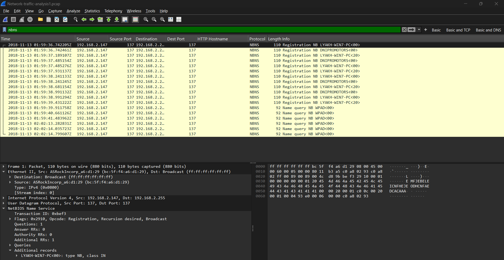

# Malware Traffic Analysis with Wireshark

**Type:** Individual lab · **Tools:** Wireshark

## Summary

I analyzed two packet captures from simulated corporate Windows networks. For each one I identified the infected machine (IP, MAC, hostname and logged-in user), found the malicious downloads and traced what the host did after it was infected.

In the second capture, **four of the six malware downloads were disguised as `.jpg`/`.png` images**. I caught them by checking the file headers instead of trusting the file names.

## Techniques

| Goal | How |
|---|---|
| MAC address and hostname | NBNS and DHCP traffic (`nbns`, `dhcp`): Ethernet II source plus NetBIOS name records |
| Logged-in user | Kerberos: `kerberos.CNameString and !(kerberos.CNameString contains "$")`. Names ending in `$` are machine accounts, so they're filtered out. |
| Malicious downloads | `http.request`, `http.response`, File → Export Objects → HTTP, Follow TCP Stream |
| Real file type | Every Windows executable starts with `4D 5A` ("MZ"), whatever its name or Content-Type says |
| Activity after infection | `ip.src==<host> && tcp.flags.syn==1 && tcp.flags.ack==0` lists new outbound connection attempts |

## Case A: Single executable download

| | |
|---|---|
| Network | 192.168.2.0/24, AD domain with DC at 192.168.2.4 |
| Infected host | 192.168.2.147 · `LYAKH-WIN7-PC` · MAC `bc:5f:f4:a6:d1:29` · user `jermija.lyakh` |
| Malware | `hxxp://micropcsystem[.]com/hojuks/vez[.]exe`, 699,392 bytes, downloaded at 2018-11-13 02:02:13 UTC |
| After infection | 13 seconds after the download, the host sent repeated SYNs to **93.87.38[.]24:3369**, likely a callback to the attacker |

## Case B: Executables disguised as images

| | |
|---|---|
| Network | 10.2.23.0/24, AD domain with DC at 10.2.23.2 |
| Infected host | 10.2.23.231 · `FERGUSON-WIN-PC` · MAC `00:11:0a:9f:c0:2d` · user `ruby.ferguson` |
| Ruled out | 10.2.23.109 (`SUTTON-WIN-PC`) only browsed normal websites |

| File | Server | Claimed type | Size (bytes) | Actual |
|---|---|---|---|---|
| troll1.jpg | 209.141.55[.]226 | image/jpeg | 122,880 | **Windows EXE** |
| Sw9JKmXqaSj.exe | 46.249.62[.]199 | octet-stream | 168,448 | Windows EXE |
| Tinx86_14.exe | 46.249.62[.]199 | octet-stream | 2,818,560 | Windows EXE |
| win.png | 85.143.218[.]7 | image/png | 270,336 | **Windows EXE** |
| tin.png | 85.143.218[.]7 | image/png | 270,336 | **Windows EXE** |
| sin.png | 85.143.218[.]7 | image/png | 270,336 | **Windows EXE** |

**After infection:** the host contacted `superhaps[.]pw/data2.php` and checked its own public IP with `ipecho[.]net/plain`. It also sent repeated requests to 190.146.112[.]216 with its hostname in the URL path, which is typical of malware reporting in to its operators.

## Takeaways

- File extensions and Content-Type headers are set by the attacker, so they can't be trusted. The file's actual bytes can.
- Identity data (DHCP, NBNS, Kerberos) is what turns "an IP did something" into "this user on this machine did something," which is what an incident responder actually needs.

## Screenshots

**Case A: identifying the infected host from NBNS.** The registrations show the hostname `LYAKH-WIN7-PC`, and the Ethernet header gives MAC `bc:5f:f4:a6:d1:29`.

*Captures not included in this repo because they contain live malware.*
