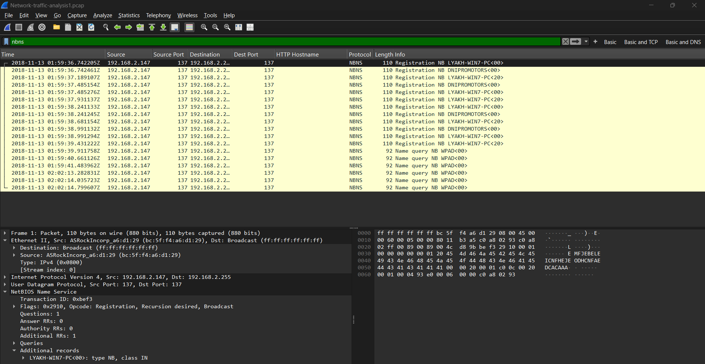

# Incident Report: Malware Downloads on Two Windows Domain Networks

| | |
|---|---|
| **Report type** | Network forensic analysis (two cases) |
| **Evidence** | Case A: `Network-traffic-analysis1.pcap` · Case B: `Network-traffic-analysis2.pcap` |
| **Affected assets** | Case A: 192.168.2.147 (`LYAKH-WIN7-PC`) · Case B: 10.2.23.231 (`FERGUSON-WIN-PC`) |
| **Overall severity** | **High** for both: confirmed executable downloads followed by outbound callbacks |
| **Analyst** | Kaushik Inguva |

> All indicators are defanged. The captures are training data containing live malware and are not included in this repository.

---

## 1. Executive summary

Two simulated corporate Windows networks were each investigated for a malware infection. In both cases the infected workstation was identified by **IP, MAC address, hostname and logged-in domain user**. Its malicious downloads were recovered, and its activity after infection was traced.

- **Case A:** user `jermija.lyakh` on `LYAKH-WIN7-PC` downloaded a **699 KB Windows executable** over plain HTTP. **13 seconds later** the host began repeated connection attempts to an external IP on a non-standard port, consistent with a malware callback.
- **Case B:** user `ruby.ferguson` on `FERGUSON-WIN-PC` received **six Windows executables**, **four of them disguised as `.jpg`/`.png` images** with image content types. The host then reported its hostname to a remote server and checked its own public IP address, which is typical post-infection check-in behavior. A second workstation on the same network was examined and **ruled out**.

**Recommendation:** isolate and reimage both workstations, reset both users' domain credentials, and block the listed indicators.

## 2. Methodology

| Objective | Technique |
|---|---|
| Host MAC and hostname | NBNS registrations and DHCP requests (`nbns`, `dhcp`): Ethernet II source plus the NetBIOS name record |
| Logged-in user | Kerberos AS/TGS traffic to the domain controller: `kerberos.CNameString and !(kerberos.CNameString contains "$")`, which excludes machine accounts (names ending in `$`) |
| Malicious downloads | `http.request` / `http.response`, *File → Export Objects → HTTP*, *Follow TCP Stream* |
| True file type | Checked each payload's first bytes. Every Windows PE executable starts with `4D 5A` ("MZ"), whatever its filename or `Content-Type` says. |
| Activity after infection | `ip.src==<host> && tcp.flags.syn==1 && tcp.flags.ack==0` to list new outbound connection attempts |
| Traffic shape | *Statistics → I/O Graph* (1 ms interval, all packets and TCP errors) |

---

## 3. Case A: `LYAKH-WIN7-PC`

### Environment

| Item | Value |
|---|---|
| LAN segment | 192.168.2.0/24 |
| AD domain | `dnipromotors[.]com` |
| Domain controller | 192.168.2.4 (`Dnipromotors-DC`) |
| Gateway | 192.168.2.1 |

### Infected host

| Attribute | Value | Source |
|---|---|---|
| IP | 192.168.2.147 | |
| MAC | `bc:5f:f4:a6:d1:29` (ASRock) | NBNS frame 1 |
| Hostname | `LYAKH-WIN7-PC` | NBNS frame 1; DHCP request, frame 385 |
| User | `jermija.lyakh` | Kerberos, frame 547 |
| OS | Windows 7 (NT 6.1) | HTTP User-Agent |



### Timeline (UTC, 2018-11-13)

| Time | Frame | Event |
|---|---|---|
| 01:59:36 | 1 | Host registers its NetBIOS name `LYAKH-WIN7-PC` |
| **02:02:13** | 718 | **HTTP GET `hxxp://micropcsystem[.]com/hojuks/vez[.]exe`** (198.54.126[.]123) |
| 02:02:15 | 1514 | `200 OK`, `application/x-msdownload`, **699,392 bytes**, payload starts with `MZ` |
| ~02:02:28 | 1526–1540 | **Repeated SYNs to 93.87.38[.]24:3369**, starting 13 seconds after the download completed |

### Assessment

The host downloaded a Windows executable over unencrypted HTTP from a domain with no legitimate business purpose. Seconds later it began trying to connect to an external IP on a non-standard port. The short gap between download and callback shows the executable ran almost immediately. The repeated SYNs with no completed handshake suggest the C2 server was unreachable or had already been taken down when the capture was made.

---

## 4. Case B: `FERGUSON-WIN-PC`

### Environment

| Item | Value |
|---|---|
| LAN segment | 10.2.23.0/24 |
| AD domain | `stormtheory[.]info` |
| Domain controller | 10.2.23.2 (`Stormtheory-DC`) |
| Gateway | 10.2.23.1 |

### Hosts examined

| Host | IP | MAC | User | Verdict |
|---|---|---|---|---|
| `FERGUSON-WIN-PC` | 10.2.23.231 | `00:11:0a:9f:c0:2d` | `ruby.ferguson` | **Infected** |
| `SUTTON-WIN-PC` | 10.2.23.109 | n/a | n/a | **Ruled out**: only normal web browsing |

### Malicious downloads

All six responses start with the `MZ` header, so they are Windows executables. **Four of the six used image filenames and image content types to look harmless.**

| File | Server | Claimed type | Size (bytes) | Actual type |
|---|---|---|---|---|
| `troll1.jpg` | 209.141.55[.]226 | `image/jpeg` | 122,880 | **Windows PE** |
| `Sw9JKmXqaSj.exe` | 46.249.62[.]199 | `application/octet-stream` | 168,448 | Windows PE |
| `Tinx86_14.exe` | 46.249.62[.]199 | `application/octet-stream` | 2,818,560 | Windows PE |
| `win.png` | 85.143.218[.]7 | `image/png` | 270,336 | **Windows PE** |
| `tin.png` | 85.143.218[.]7 | `image/png` | 270,336 | **Windows PE** |
| `sin.png` | 85.143.218[.]7 | `image/png` | 270,336 | **Windows PE** |

`win.png`, `tin.png` and `sin.png` are the same size and come from the same server, so they are likely the same payload, or builds of the same payload, delivered more than once.

### Activity after infection

| Destination | Behavior | Interpretation |
|---|---|---|
| `superhaps[.]pw/data2.php` | HTTP request | C2 check-in |
| `ipecho[.]net/plain` | Returns the caller's public IP | Malware finding out its external IP |
| 190.146.112[.]216 | Repeated requests with `FERGUSON-WIN-PC` in the URL path | Reporting the victim hostname to the operator |

### Assessment

The host was compromised by several payloads from three servers. Disguising executables as images is meant to get past content filters and analysts who trust file extensions or MIME types. After infection the host fingerprinted itself (public IP and hostname) and reported to remote infrastructure, which shows the malware was active and talking to its operators.

---

## 5. MITRE ATT&CK mapping

| Tactic | Technique | Case | Evidence |
|---|---|---|---|
| Command and Control | **T1105** Ingress Tool Transfer | A, B | Executables downloaded over HTTP |
| Defense Evasion | **T1036.008** Masquerading: Masquerade File Type | B | PE files served as `.jpg`/`.png` with image content types |
| Command and Control | **T1071.001** Application Layer Protocol: Web Protocols | B | HTTP check-ins to `superhaps[.]pw` and 190.146.112[.]216 |
| Command and Control | **T1571** Non-Standard Port | A | Callback attempts to TCP port 3369 |
| Discovery | **T1016.001** System Network Configuration Discovery: Internet Connection Discovery | B | Public-IP lookup via `ipecho[.]net/plain` |
| Discovery | **T1082** System Information Discovery | B | Hostname sent to the operator in the URL path |

## 6. Recommendations

1. **Isolate and reimage** 192.168.2.147 and 10.2.23.231. Don't rely on cleaning them.
2. **Reset the domain credentials** for `jermija.lyakh` and `ruby.ferguson`, and review Kerberos logs for any use of those accounts from other hosts.
3. **Block the indicators** below at the web proxy, DNS and firewall.
4. **Inspect file content, not names:** configure the web proxy or IDS to flag HTTP responses whose body starts with `MZ` but whose `Content-Type` isn't an executable type.
5. **Restrict executable downloads over plain HTTP** from uncategorized or newly registered domains.
6. **Alert on egress** to non-standard ports from workstations, and on requests to public-IP lookup services, which legitimate business software rarely uses.

## 7. Indicators of compromise

| Type | Indicator | Case | Notes |
|---|---|---|---|
| URL | `hxxp://micropcsystem[.]com/hojuks/vez[.]exe` | A | 699,392-byte PE |
| IP | 198.54.126[.]123 | A | Hosts `micropcsystem[.]com` |
| IP:port | 93.87.38[.]24:3369 | A | Callback target |
| URL | `hxxp://209.141.55[.]226/troll1[.]jpg` | B | PE disguised as JPEG |
| URL | `hxxp://46.249.62[.]199/Sw9JKmXqaSj[.]exe` | B | PE |
| URL | `hxxp://46.249.62[.]199/Tinx86_14[.]exe` | B | PE |
| URL | `hxxp://85.143.218[.]7/win[.]png`, `tin[.]png`, `sin[.]png` | B | PEs disguised as PNG |
| Domain | `superhaps[.]pw` (`/data2.php`) | B | C2 check-in |
| IP | 190.146.112[.]216 | B | Receives the victim hostname |

## Appendix: Wireshark filters used

```
nbns                                                         # hostname and MAC
dhcp                                                         # hostname confirmation
kerberos.CNameString and !(kerberos.CNameString contains "$")   # user account
http.request                                                 # downloads
ip.src==<host> && tcp.flags.syn==1 && tcp.flags.ack==0       # outbound attempts
```
