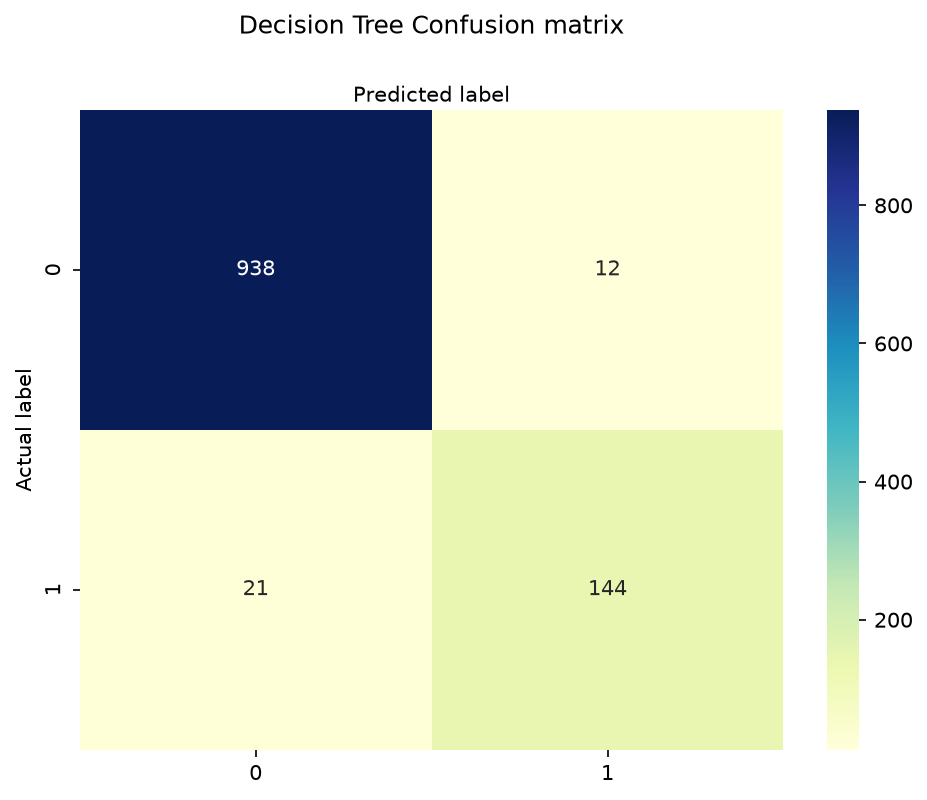

# SMS Spam Classifier

**Type:** Individual lab · **Tools:** Python, scikit-learn, pandas, seaborn

## Summary

I built two text classifiers to separate spam from legitimate ("ham") SMS messages and compared them. The **Decision Tree** caught far more spam (recall 0.87 vs. 0.67). **Logistic Regression** almost never flagged a legitimate message by mistake (precision 0.98). Which one is better depends on whether missed spam or false alarms cost more.

## Data

[UCI SMS Spam Collection](https://archive.ics.uci.edu/dataset/228/sms+spam+collection): 5,574 labeled messages, about 13% spam.

## Method

1. Turned the messages into **TF-IDF** vectors (words weighted by how distinctive they are).
2. Split the data 80/20 into training and test sets (`random_state=0`), giving a test set of 1,115 messages: 950 ham and 165 spam.
3. Trained **Logistic Regression** and a **Decision Tree** and evaluated both on the test set.

## Results

| Model | Confusion matrix `[[TN FP] [FN TP]]` | Accuracy | Precision | Recall | F1 |
|---|---|---|---|---|---|
| Logistic Regression | `[[948 2] [55 110]]` | 0.949 | **0.982** | 0.667 | 0.794 |
| Decision Tree | `[[938 12] [21 144]]` | **0.970** | 0.923 | **0.873** | **0.897** |



## Analysis

- **The Decision Tree is better overall.** It caught 144 of 165 spam messages, compared with 110, and had higher accuracy and F1. It can learn sharp rules on spam keywords like "free," "prize" or "claim."
- **Logistic Regression is more cautious.** Only 2 false positives, but it let 55 spam messages through.
- **Accuracy alone is misleading here.** With 85% ham, a model that never flags anything would still score 85% accuracy. Precision, recall and F1 show the real trade-off.

## Run it

```bash
pip install -r requirements.txt
python sms_spam_classifier.py
```
