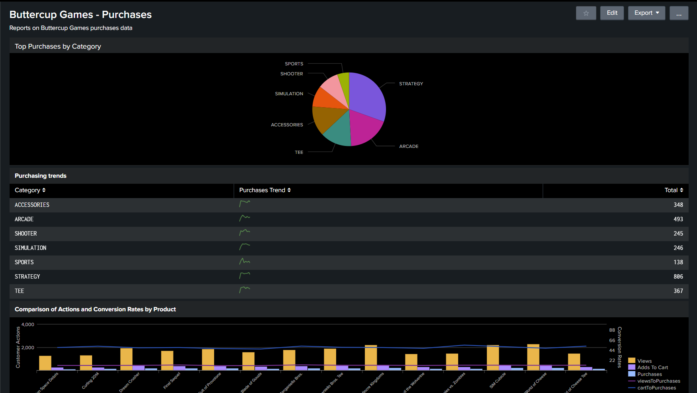
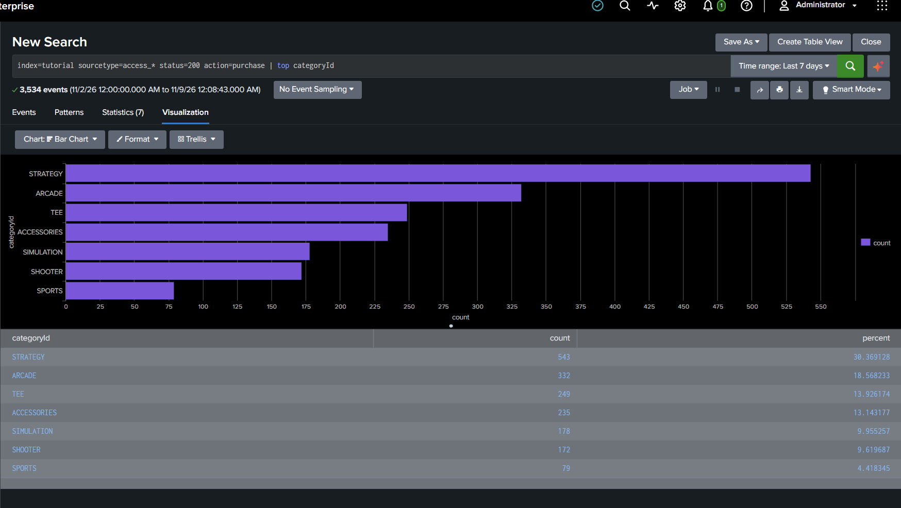
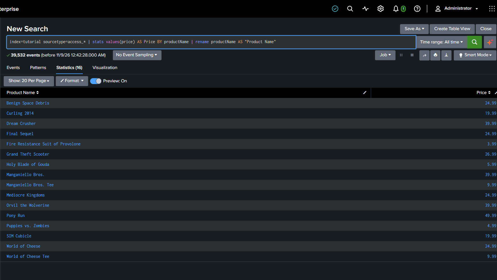

# Splunk SIEM: Search, Enrichment, Reports and Dashboards

**Type:** Individual lab · **Tools:** Splunk Enterprise 10.6, SPL

## Summary

I worked through the full Splunk workflow on web-store access logs (about 39.5K events): **loading data → searching → enriching with lookups → reporting → dashboards**.

## What I built

Example searches:

```spl
sourcetype=access_* status=200 action=purchase categoryId=simulation

sourcetype=access_* status=200 action=purchase | top categoryId

sourcetype=access_* | stats values(price) AS Price BY productName
  | rename productName AS "Product Name"
```

- Searched by field and filtered with custom and relative time ranges
- Used a **lookup table** to add product names and prices to the raw events
- Used `top`, `stats`, `chart`, `eval` and `rename`, plus a **subsearch**
- Saved searches as **reports**, built a basic chart and an **overlay chart** (customer actions vs. conversion rates), and put them on a **dashboard**

**Lesson learned:** I loaded the same data twice by accident, which duplicated every event. I fixed it by sending a clean load into a separate index. That's a small version of a real SIEM problem: duplicate data inflates counts and causes false alerts.

## Screenshots

**The finished dashboard:** top purchases by category, purchasing trends with sparklines, and an overlay chart of views, cart adds and purchases next to conversion rates.


**`top categoryId` shown as a bar chart** (last 7 days)


**Price per product,** using `stats values(price) BY productName` on lookup-enriched events


## Reflection

The tutorial covered the full SIEM workflow: ingesting data, searching it, enriching it, and presenting it in reports and dashboards. I learned how SPL chains commands with pipes, starting with simple field searches and working up to `top`, `stats`, `chart`, `eval`, `rename`, subsearches, lookups and overlay charts.
